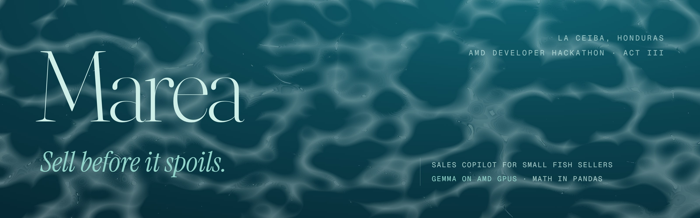
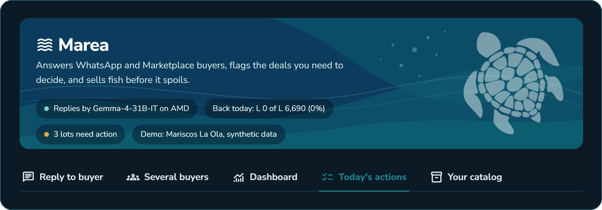
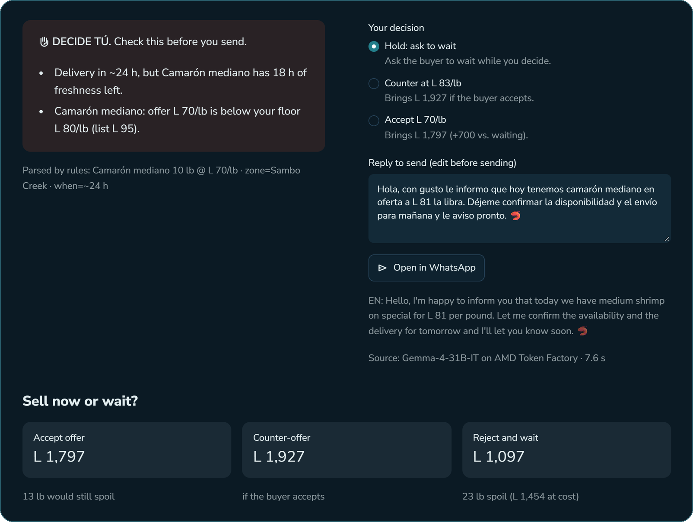
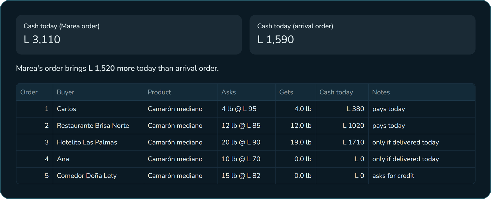
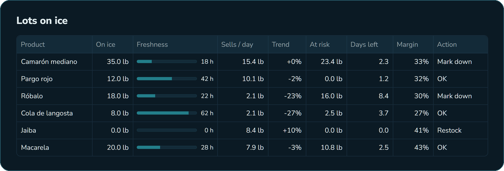
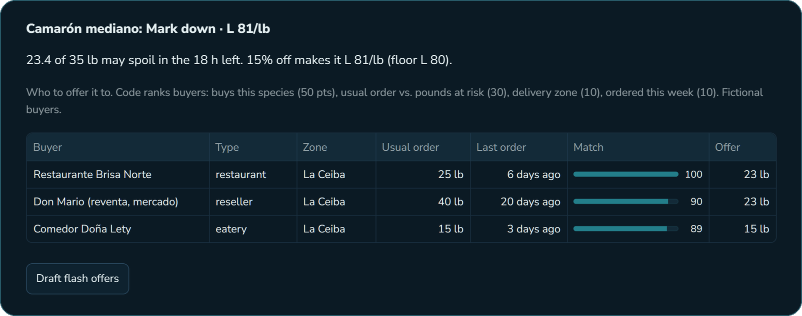
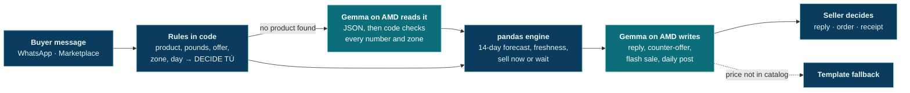

<div align="center">



<br>

**A sales copilot for small-scale fish sellers in Honduras who sell on WhatsApp and Facebook Marketplace.**<br>
Rules in code read every buyer message, Gemma on AMD GPUs reads the ones the rules cannot, pandas does every calculation, and Gemma writes the replies.<br>
The seller always decides.

<br>

[](https://marea-copilot.streamlit.app/)
[](https://youtu.be/xyurcs1yg2g)
[](slides/marea-deck.pdf)


[](LICENSE)

<sub>AMD Developer Hackathon · ACT III · Reinvent Commerce track · All data in this repo is synthetic</sub>

</div>


## Contents

[The problem](#the-problem) · [What Marea does](#what-marea-does) · [How it works](#how-it-works) · [Where AMD runs](#where-amd-runs) · [The math](#the-math-no-llm) · [Proof](#proof) · [Run it](#run-it-locally) · [Project structure](#project-structure) · [Limits](#honest-limits)


## The problem

| **35%** | **1 to 3 days** | **Every buyer haggles** |
|:---|:---|:---|
| of the world's fisheries and aquaculture harvest is lost or wasted every year ([FAO](https://www.fao.org/gender/news/news-detail/How-Does-Gender-Influence-Food-Loss-and-Waste-in-Fish-Value-Chains-/en)). | is how long fresh fish lasts on ice. | on WhatsApp, one message at a time, while the clock runs. |

One message hides a real decision:

> *"buenas, te doy 700 lps x las 10 lbs de camarón, me las lleva mañana a Sambo Creek?"*

L 70 a pound is below the seller's floor. But the shrimp has 18 hours of freshness left, and tomorrow it may not sell at all. **Accept, counter, or wait?** Today the seller guesses. Marea does the math.


## What Marea does



### 1 · Reply to a buyer, with DECIDE TÚ

Paste a buyer message. Rules in code read each product, pounds, offer, zone and day, including multi-product orders and "L 1,100 for everything" offers. When the rules find no catalog product (slang like "camaroncitos", typos like "kmaron", a hotel writing "red snapper" in English), **Gemma on AMD reads the message** into JSON and code keeps only what it can verify: every number must be written in the message and the zone must be one the seller serves. If a rule triggers, the seller sees **DECIDE TÚ** with the reasons, and three options priced in lempiras: hold, counter-offer or accept. The reply is drafted by Gemma on AMD and opens in WhatsApp with one click. Confirming the order updates stock everywhere and writes a WhatsApp-ready receipt.



### 2 · Several buyers, one lot

On Marketplace, five people ask for the same shrimp at once. Marea ranks them with code: buyers who pay today and can be served as asked go first, then deliveries that only work today, then credit. Within each group, the highest price per pound wins. In the demo this brings **L 3,110 today instead of L 1,590** answering in arrival order.



### 3 · Dashboard

Lots on ice with freshness bars, demand, pounds at risk and days of cover, plus the day's break-even (*librar la cava*: fish at cost + ice + fuel). A time slider simulates the next 36 hours, so the seller sees a lot go bad before it happens.



### 4 · Today's actions

Fixed rules choose the action for each lot: mark down, restock or discard. For each lot marked down, code ranks regular buyers and Gemma drafts a flash-sale message for each one. **Post today's catch** drafts one WhatsApp Status or Marketplace post with what is on ice; code checks every price in it against the catalog. Nothing is sent automatically.



<details>
<summary><b>More: language, night mode, catalog</b></summary>

<br>

- The interface switches between English and Spanish. Messages to buyers, receipts and flash sales are always in Spanish.
- Dark mode follows the phone's setting, for sellers who plan the next day at night.
- **Your catalog** is editable: prices, floor prices, pounds and shelf life, with warnings for typos (a list price 3× the floor) and floors below cost. The parser benchmark runs there too.

</details>


## How it works



> **The model never sets a price.** Prices, quantities, flags and actions come from code and are passed to the model as facts. Code then checks every price the model writes; if one is not in the catalog, Marea uses a template and says so.


## Where AMD runs

| | |
|:---|:---|
| **Model** | `Gemma-4-31B-IT` (Google), served on AMD GPUs |
| **Provider** | AMD Token Factory (AMD Radeon Cloud), OpenAI-compatible endpoint |
| **Endpoint** | `https://developer.amd.com.cn/radeon/api/v1/chat/completions` |
| **Client** | [`core/llm.py`](core/llm.py) · `requests`, 30 s timeout, retries only 429 and 502/503 with short backoff |
| **The model reads** | buyer messages the rules cannot read, into JSON (`response_format: json_object`); code drops any number not written in the message and any zone the seller does not serve |
| **The model writes** | reply drafts, counter-offers, acceptances, flash-sale messages, the daily post, plain-language explanations |
| **The model never** | sets a price, picks an action, or sends anything |
| **If Gemma is slow** | after 15 s (12 s for reading), one try on `DeepSeek-V4-Flash` on the same AMD endpoint; the screen names the model that answered |
| **If AMD is down** | the app falls back to offline templates and labels the source on screen |

The model is one setting (`AMD_MODEL`); any chat model in the Token Factory catalog works. Gemma does not "think" by default, so each reply stays short and cheap against the team's daily cap. Token Factory keeps prompts and outputs for about 2 days; everything sent is synthetic.


## The math (no LLM)

| Quantity | Rule |
|:---|:---|
| Demand forecast | 14-day moving average of pounds sold per day |
| Pounds at risk | stock − avg lb/day × hours of freshness left ÷ 24 |
| Mark down | half or less of shelf life left and stock at risk: 10% off, or 15% if more than 40% of the lot is at risk; never below the floor |
| Restock | cover 2 days of demand |
| Discard | past shelf life; the loss is shown at cost |
| Sell now or wait | accept = offer × pounds + list × what other buyers still take · wait = list × what other buyers take before the lot spoils |
| Walk-away price | lowest price per pound at which selling now still beats waiting |
| Counter-offer | halfway between offer and list, never below the walk-away price |
| Buyer match (0–100) | buys this species 50 · usual order vs. pounds at risk 30 · delivery zone 10 · ordered this week 10 |

Fish on ice is a sunk cost, so options are compared on money coming in. In the demo, accepting L 70/lb brings **L 1,797** against **L 1,097** for waiting: **L 700 more**, because 23 pounds would spoil.

<details>
<summary><b>When the seller sees DECIDE TÚ</b></summary>

<br>

Rules in [`core/guard.py`](core/guard.py), not the LLM, raise it when a message has: an offer below the floor or below list price (per product or for the whole order), a request for a lower price, more pounds than in stock, an out-of-stock or closed-season product, delivery after the lot loses freshness, delivery outside the seller's zones, pay-later, an invoice, cleaning or filleting, or a request for something free. A message that names no product gets today's catch and prices instead of a stall.

</details>


## Proof

| Check | Result | Command |
|:---|:---:|:---|
| Parser on 30 synthetic messages in Honduran WhatsApp style: typos, "lps", numbers in words, totals vs. per-pound offers, sarcasm, several products, a buyer who changes their mind | **30/30** | `python tests/test_guard.py` |
| Sell-now-or-wait math | **4/4** | `python tests/test_offer.py` |
| Several-buyers ranking (L 3,110 vs. L 1,590) | **1/1** | `python tests/test_queue.py` |
| Code checks on what the model extracts: invented numbers and zones dropped, totals per pound, junk JSON | **4/4** | `python tests/test_extract.py` |
| 10 messages the rules cannot read (slang, diminutives, typos, English fish names): rules alone vs. rules + Gemma on AMD | **0/10 → 10/10** | in the app: **Your catalog → Gemma test** (10 live calls) |

The test messages and labels were drafted with an LLM's help and reviewed by hand; they are not real conversations. The 10/10 was measured on the live app with Gemma-4-31B-IT on AMD Token Factory on Oct 17, 2026; a model run can vary, and the test is there so anyone can run it again.


## Run it locally

```bash
git clone https://github.com/xoradato/marea.git
cd marea
pip install -r requirements.txt
cp .env.example .env        # add your AMD Token Factory key
set -a; source .env; set +a
streamlit run app.py
```

Or with Docker (the key is passed at run time, never built into the image):

```bash
docker build -t marea .
docker run -p 8501:8501 --env-file .env marea
```

Without a key the app runs on offline templates, so the rules, the math and the dashboard can still be tested. On Streamlit Cloud, put `AMD_API_BASE`, `AMD_API_KEY` and `AMD_MODEL` in **App settings → Secrets**. Never commit keys.


## Project structure

```text
marea/
├── app.py                 Streamlit UI: five tabs, sidebar, header
├── core/
│   ├── guard.py           rule-based parser, DECIDE TÚ flags, checks on what the model extracts
│   ├── analytics.py       pandas engine: forecast, risk, actions, sell now or wait
│   ├── buyer_queue.py     several buyers, one lot: ranking and allocation
│   ├── copilot.py         prompts for the model (read and write) + template fallbacks + price check
│   ├── llm.py             AMD Token Factory client
│   ├── benchmark.py       parser and Gemma benchmarks shown in the app
│   ├── i18n.py            English / Spanish text
│   └── ui.py              header, panels, CSS
├── data/                  synthetic seller, catalog, sales, buyers (generate_data.py)
├── tests/                 parser, offer, queue and extraction tests + labeled messages
├── slides/                pitch deck (HTML with animations, PDF) and cover
├── assets/                logo, turtle icon, README images
└── Dockerfile             container for the app (key passed at run time)
```


## Honest limits

- **All data is synthetic**, generated by [`data/generate_data.py`](data/generate_data.py). It does not describe any real seller or buyer.
- **No WhatsApp integration yet.** The seller pastes messages in and copies replies out.
- **The business model is a hypothesis**: a low monthly subscription per seller or per cooperative, still to be validated with real sellers.


<div align="center">

**Marea** · *Sell before it spoils.*

[Live demo](https://marea-copilot.streamlit.app/) · [Demo video](https://youtu.be/xyurcs1yg2g) · [Pitch deck](slides/marea-deck.pdf) · [Animated deck](slides/marea-deck.html)

<sub>Sea turtle icon: <a href="https://www.iconsdb.com/white-icons/turtle-icon.html">iconsDB.com</a>, CC0 1.0, faded and hosted in this repo. Code under the <a href="LICENSE">MIT License</a>.</sub>

</div>
